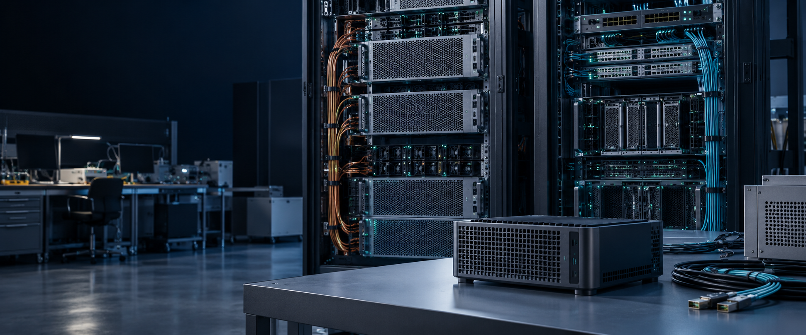
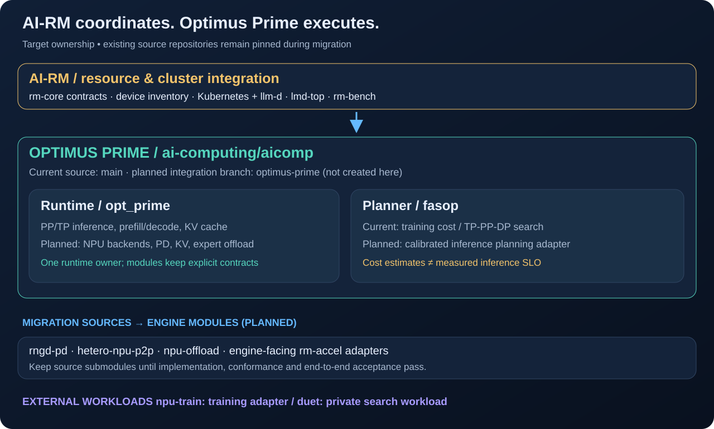
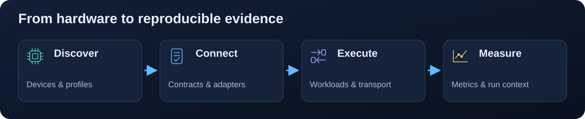

<p align="center"></p>

<p align="center">
  <a href="README.md">English</a> · <strong>한국어</strong><br>
  <a href="docs/ko/README.md">문서 홈</a> · <a href="docs/ko/engine-integration.md">Optimus Prime</a> · <a href="docs/ko/architecture.md">아키텍처</a> · <a href="docs/ko/getting-started.md">시작하기</a>
</p>

# AI-RM · AI 반도체 통합 자원관리

**자원 통합의 중심은 AI-RM, 추론 엔진 통합의 중심은 Optimus Prime입니다.**

AI-RM은 **「AI 반도체 통합 자원관리 기술 개발」 과제의 최상위 통합 저장소**입니다. GPU, FuriosaAI RNGD, Rebellions ATOM, CPU, GB10 통합메모리 기술을 **Kubernetes + llm-d** 환경에 연결합니다. 추론 엔진 기술은 **[`aicomp`의 Optimus Prime](https://github.com/ai-computing/aicomp)**으로 통합하고 **FASOP**을 그 안의 계획·탐색 요소로 포함하는 방향입니다.

AI-RM은 자원·클러스터 통합, 공통 계약, 고정 소스 버전, 운영·검증 체계를 관리합니다. **엔진 통합은 이번 문서·설정에 반영한 계획이며 구현 완료가 아닙니다.** 기존 저장소는 통합 엔진 구현·검증 전까지 소스로 유지합니다. `aicomp`의 통합용 브랜치 이름은 `optimus-prime`을 제안하며 이번 작업에서 생성·활성화하지 않습니다. [통합 설계](docs/ko/engine-integration.md)와 [현재 상태](docs/ko/status.md)를 참고하세요.


*AI로 생성한 실사풍 환경 이미지입니다. 실제 과제 구축 사진이나 배포 증빙이 아닙니다.*

## 어떤 기술을 연결하나요?

| | 연구 영역 | 목적 |
|---|---|---|
|  | **이종 장치 추상화** | 벤더마다 다른 장치 탐지·능력을 공통 모델로 표현합니다. |
|  | **메모리 계층 활용** | NPU KV 전송, MoE 오프로딩, 통합메모리 CPU–GPU 협업을 연구합니다. |
|  | **추론·학습 실행** | PD 분리 서빙과 NPU 학습 워크로드를 연결합니다. |
|  | **클러스터 통합** | 라우팅·장치 프로파일·모델 스토어·모니터링을 연결합니다. |
|  | **재현 가능한 측정** | 지연·처리량·전력·SLO를 실행 조건과 과제 증빙에 연결합니다. |

## 5계층 아키텍처


공통 계약은 [`rm-core`](https://github.com/ai-computing/rm-core)에 정의합니다. 구성요소는 adapter, 이름으로 선택하는 entry point, 공통 측정 형식으로 연결합니다. 서브모듈 커밋이 특정 통합 버전의 조합을 고정합니다.

## Optimus Prime 중심의 엔진 통합



| 영역 | 통합 책임 | 현재와 계획의 경계 |
|---|---|---|
| **추론 런타임** | Optimus Prime · `aicomp/opt_prime` | PP/TP 추론·KV API는 기존 소스에 있으며 NPU·PD·전송·offload 이전은 계획 |
| **계획·탐색** | Optimus Prime 내부 FASOP · `aicomp/fasop` | 현재는 이종 GPU **학습** 비용 탐색, 추론용 보정과 adapter는 후속 구현 |
| **자원·클러스터·운영** | AI-RM + rm-core + llm-d-setup + lmd-top/rm-bench | 자원 계약·Gateway/EPP·관측·실측 증빙은 상위 통합 책임 |
| **외부 워크로드** | npu-lora, 비공개 선택 duet | 학습·검색을 명시적인 adapter로 연결, 비공개 코드는 유지 |

[계획 설정](config/engine-integration.yaml)에 소유권·이전 소스·브랜치·전환 기준을 기록했습니다. **현재 CLI가 읽는 실행 설정은 아닙니다.** 자세한 내용은 [Optimus Prime + FASOP 통합 설계](docs/ko/engine-integration.md)에 있습니다.

## 현재 소스 구성요소

아래 저장소는 전환 중 실제 실행 소스로 유지합니다. `rm_abstract_layer`의 엔진 실행 부분, PD, KV 전송, 전문가 offload는 Optimus Prime 모듈로 통합하는 방향이며 L1 장치 탐지·능력 게시 책임은 유지합니다.

| 계층 | 구성요소 | 역할 |
|---|---|---|
| **L1 · 가속기** | [rm_abstract_layer](https://github.com/ai-computing/rm_abstract_layer) | 장치 탐지·능력 모델·엔진 및 자원 플러그인 |
| **L2 · 메모리** | [hetero-npu-p2p](https://github.com/ai-computing/hetero-npu-p2p) | 같은 호스트의 호환 NPU 간 completion-fenced KV 전송 |
| **L2 · 메모리** | [npu-offload](https://github.com/ai-computing/npu-offload) | Hot expert는 NPU HBM, cold expert 실행은 호스트 CPU |
| **L2 · 메모리** | **duet** · 비공개·선택 사항 | GB10에서 CPU 그래프 순회 + GPU 거리 계산으로 벡터 검색 |
| **L3 · 실행** | [rngd-pd](https://github.com/ai-computing/rngd-pd) | RNGD prefill + ATOM decode 분리 서빙 |
| **L3 · 실행** | [npu-lora](https://github.com/ai-computing/npu-lora) | 추론 지향 NPU의 LoRA·full fine-tuning 연구 |
| **L4 · 클러스터** | [llm-d-setup](https://github.com/ai-computing/llm-d-setup) | Kubernetes + llm-d, 라우팅·스토어·모니터링 |
| **L5 · 운영** | [lmd-top](https://github.com/ai-computing/lmd-top) | llm-d 클러스터 관측·운영 TUI |
| **L5 · 운영** | [rm-bench](https://github.com/ai-computing/rm-bench) | Trace 재생·합성 부하·지연 측정 |

`duet`은 비공개로 유지됩니다. 공개 구성요소를 받는 절차와 접근 상태는 [시작하기](docs/ko/getting-started.md)와 [현재 상태](docs/ko/status.md)를 참고하세요.

## 요청과 데이터의 흐름

**PD 분리 서빙:** 목표는 Gateway/EPP가 Optimus Prime prefill·decode worker를 연결하는 구조입니다. 기존 RNGD/ATOM PD 기술은 이전 소스입니다. KV 경로는 명시적으로 선택하고 P2P의 동일 호스트·하드웨어·ABI 조건을 유지합니다. 통합 엔진 백엔드와 llm-d adapter는 후속 구현입니다.


**세 가지 메모리 연구:** KV 전송, MoE 전문가 오프로딩, 통합메모리 벡터 검색은 대상 데이터와 실행 방식이 다릅니다.


책임과 제약은 [아키텍처](docs/ko/architecture.md), [인터페이스](docs/ko/interfaces.md), [연구 시나리오](docs/ko/research-scenarios.md)에서 설명합니다.

## 시작하기

### 가속기 없이 문서와 구조 살펴보기

```bash
git clone https://github.com/ai-computing/ai-rm.git
cd ai-rm
python3 tools/airm.py list
python3 tools/check_sensitive.py .
```

문서를 읽는 데 클러스터나 `duet` 권한은 필요하지 않습니다. 초기화하지 않은 구성요소는 `list`에서 **not fetched**로 표시됩니다.

### 공개 구성요소 받기

`duet` 권한이 없으면 `--recursive` 대신 공개 경로를 지정합니다.

```bash
git submodule update --init -- \
  components/l1-accel/rm_abstract_layer \
  components/l2-memory/hetero-npu-p2p \
  components/l2-memory/npu-offload \
  components/l3-serving/rngd-pd \
  components/l3-serving/npu-lora \
  components/l4-cluster/llm-d-setup \
  components/l5-ops/rm-bench \
  components/l5-ops/lmd-top
```

위 경로는 정리된 `lmd-top`을 포함해 공개 상태입니다. `make setup`은 모든 서브모듈을 초기화하므로 비공개 `duet`도 받으려 합니다. 공개 구성요소만 사용할 때는 Python CLI를 쓰세요. 구성요소별 요구 사항은 [시작하기](docs/ko/getting-started.md)에 있습니다. 이는 현재 소스 설치 절차이며 계획된 통합 엔진을 설치하는 명령은 아닙니다.

### 사용 권한이 있는 클러스터 준비

Python 3.8+, Git과 구성요소별 도구를 갖춘 Linux 환경에서 실행합니다.

```bash
python3 -m pip install PyYAML
python3 tools/airm.py doctor
python3 tools/airm.py setup --layer l3-serving
python3 tools/airm.py test --layer l3-serving
mkdir -p deploy/clusters/local
cp deploy/clusters/example/cluster.example.env deploy/clusters/local/cluster.local.env
# 추적되지 않는 cluster.local.env에 사이트 값을 입력합니다.
python3 tools/airm.py deploy --cluster local --dry-run --layer l3-serving
```

배포 도구는 `deploy.manifests`를 `kubectl`로 적용하며 매니페스트가 없으면 건너뜁니다. Client dry run은 로컬 Kubernetes 설정이 필요하고 실제 배포 성공을 보장하지 않습니다. [배포 문서](deploy/README.ko.md)를 참고하세요.

## 문서

**[한국어 문서 홈](docs/ko/README.md)**과 **[영문 문서 홈](docs/README.md)**에서 위키처럼 주제별로 탐색할 수 있습니다.

| 내용 | 문서 |
|---|---|
| 과제 목적·범위·상태 | [개요](docs/ko/project-overview.md) · [현재 상태](docs/ko/status.md) |
| 엔진 통합 방향 | [Optimus Prime + FASOP](docs/ko/engine-integration.md) · [계획 설정](config/engine-integration.yaml) |
| 계층과 워크로드 | [아키텍처](docs/ko/architecture.md) · [연구 시나리오](docs/ko/research-scenarios.md) |
| 실행 환경 | [시작하기](docs/ko/getting-started.md) · [배포](deploy/README.ko.md) |
| 구현 연결 | [인터페이스](docs/ko/interfaces.md) · [통합 가이드](docs/ko/integration-guide.md) · [계약](docs/ko/component-contract.md) |
| 저장소별 작업 | [구성요소 디렉터리·작업 카드](docs/components/README.md) |
| 성과 측정·용어 | [성과지표](docs/ko/kpi-map.md) · [용어집](docs/ko/glossary.md) |
| 기여·이미지 | [기여 방법](CONTRIBUTING.md) · [이미지 출처·프롬프트](docs/assets/README.md) |

## 연구 결과와 증빙



MFU, 전력효율, 이종 자원 범위, SLO 달성률, 메모리 통합, 확장성, 응용 서비스를 구성요소와 연결합니다. 공개 문서에는 측정 방법과 대응 관계를 담고, 미공개 수치와 과제 증빙은 지정된 비공개 기록에서 관리합니다. [성과지표 대응표](docs/ko/kpi-map.md)를 참고하세요.

## 기여와 라이선스

[기여 방법](CONTRIBUTING.md), 구성요소 카드, [rm-core 규범 문서](https://github.com/ai-computing/rm-core/blob/main/PROTOCOL.md)를 확인하세요. 사이트 설정과 자격 증명은 추적되지 않는 설정에 두고 공개 전에 `make check`를 실행합니다.

통합 저장소는 [BSD-3-Clause](LICENSE)를 따릅니다. 각 구성요소에는 해당 저장소의 라이선스가 적용됩니다.
