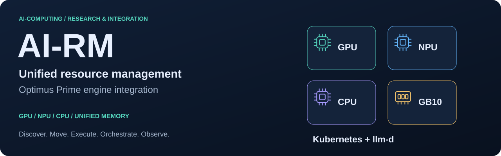
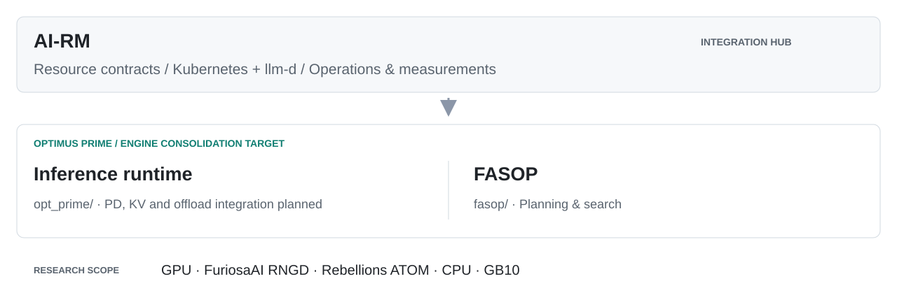

<div align="center">

<a href="docs/ko/project-overview.md"></a>

<h3>이종 AI 인프라를 위한 통합 자원관리</h3>

<p>
  <a href="README.md">English</a> · <strong>한국어</strong>
</p>

<p>
  <a href="https://github.com/ai-computing/ai-rm/actions/workflows/check-docs.yml"></a>
  <a href="https://github.com/ai-computing/rm-core/blob/main/PROTOCOL.md"></a>
  <a href="https://github.com/ai-computing/rm-core"></a>
  <a href="deploy/README.ko.md"></a>
  <a href="docs/ko/status.md"></a>
  <a href="LICENSE"></a>
</p>

<p>
  <a href="docs/ko/getting-started.md"><b>시작하기</b></a> ·
  <a href="docs/ko/architecture.md"><b>아키텍처</b></a> ·
  <a href="docs/ko/engine-integration.md"><b>Optimus Prime</b></a> ·
  <a href="docs/components/README.md"><b>구성요소</b></a> ·
  <a href="docs/ko/status.md"><b>현재 상태</b></a> ·
  <a href="docs/ko/README.md"><b>문서</b></a>
</p>

</div>

---

**AI-RM**은 **「AI 반도체 통합 자원관리 기술 개발」 과제의 통합 허브**입니다. 공통 계약, 고정된 구성요소 버전,
재현 가능한 측정을 통해 **GPU·NPU(FuriosaAI RNGD, Rebellions ATOM)·CPU·GB10 통합메모리 연구**를
**Kubernetes + llm-d** 환경에 연결합니다. 추론 엔진 기술은 **Optimus Prime**으로 모으고, **FASOP**을 그 안의
계획 요소로 둡니다.

## ✨ 무엇을 연결하나

<table>
<tr>
<td width="33%" valign="top">
<br>
<b>모든 장치를 하나의 모델로</b><br>
GPU·NPU·CPU·통합메모리 시스템을 탐지하고 그 능력을 하나의 <code>AcceleratorProfile</code> 모델로 게시합니다.
</td>
<td width="33%" valign="top">
<br>
<b>KV·전문가를 이름으로 이동</b><br>
NPU↔NPU KV 전송, NPU↔호스트 전문가 offload, CPU↔GPU 통합메모리를 공통 <code>KVTransport</code>·메모리 계층 계약 뒤에 둡니다.
</td>
<td width="33%" valign="top">
<br>
<b>하나의 엔진 목표</b><br>
Prefill/decode, KV, offload 경로를 Optimus Prime으로 모으고 FASOP이 병렬화와 배치를 계획합니다.
</td>
</tr>
<tr>
<td width="33%" valign="top">
<br>
<b>Kubernetes + llm-d 기본</b><br>
Gateway, InferencePool/EPP, 모델 저장소, 모니터링을 llm-d가 이미 제공하는 확장 지점으로 연결합니다.
</td>
<td width="33%" valign="top">
<br>
<b>하나의 지표 언어</b><br>
TTFT, TPOT, tok/s, 전력, MFU를 모든 계층이 같은 <code>airm_*</code> 이름으로 보고해 콘솔부터 성과지표 표까지 같은 숫자를 봅니다.
</td>
<td width="33%" valign="top">
<br>
<b>계약으로 연결</b><br>
구성요소끼리 직접 import하지 않습니다. 각자 <a href="https://github.com/ai-computing/rm-core">rm-core</a> 어댑터를 등록하고 적합성 검사로 확인합니다.
</td>
</tr>
</table>

## 🏗 아키텍처

<picture>
  <source media="(max-width: 600px) and (prefers-color-scheme: dark)" srcset="docs/assets/overview-mobile-dark.svg">
  <source media="(max-width: 600px)" srcset="docs/assets/overview-mobile-light.svg">
  <source media="(prefers-color-scheme: dark)" srcset="docs/assets/overview-dark.svg">
  
</picture>

<details>
<summary><b>5개 기술 계층</b></summary>
<br>


| 계층 | 책임 | 구성요소 |
|:-:|---|---|
| **L5** | 관측·운영 | lmd-top · rm-bench |
| **L4** | 클러스터·배치 | hetero-llm-d · rm-controller · FASOP 어댑터 *(계획)* |
| **L3** | 통합 엔진 | Optimus Prime · rngd-pd *(이전 소스)* · npu-train |
| **L2** | 메모리·전송 | hetero-npu-p2p · npu-offload · duet |
| **L1** | 가속기 추상화 | rm-accel |

자세히: [아키텍처](docs/ko/architecture.md) · [인터페이스](docs/ko/interfaces.md) · [엔진 통합 설계](docs/ko/engine-integration.md)
</details>

> [!IMPORTANT]
> **통합 진행 단계입니다.** [`aicomp`](https://github.com/ai-computing/aicomp)의 Optimus Prime을 통합 추론 엔진으로 두는 방향이며, 통합 브랜치와 어댑터는 아직 활성화되지 않았습니다. FASOP의 추론용 계획도 후속 구현입니다. 기존 저장소는 고정된 실행 소스로 유지합니다. 구현과 계획의 구분은 [현재 상태](docs/ko/status.md)를 참고하세요.

## 🚀 빠른 시작

가속기나 비공개 구성요소 권한 없이 살펴볼 수 있습니다.

```bash
git clone https://github.com/ai-computing/ai-rm.git && cd ai-rm
python3 tools/airm.py list            # 구성요소 · 계층 · 버전 · 배포 가능 여부
python3 tools/check_sensitive.py .    # 내부 주소·토큰·키 검사
```

<details>
<summary><b>구성요소 받기, 설치, 테스트</b></summary>
<br>

[공개 구성요소를 경로로 선택해 초기화](docs/ko/getting-started.md#공개-구성요소-선택-초기화)한 뒤
(재귀 clone은 비공개 `duet`도 받으려 합니다):

```bash
make doctor                     # 필수 도구와 빠진 항목
make setup                      # 구성요소 설치 (LAYER=l2-memory로 범위 제한)
make test                       # 가속기 없이 도는 빠른 테스트
python -m rm_core.conformance   # 계약 검사: PASS / SKIP(하드웨어 없음) / FAIL
```

전체 절차: [시작하기](docs/ko/getting-started.md).
</details>

<details>
<summary><b>Kubernetes + llm-d 클러스터에 배포</b></summary>
<br>

```bash
mkdir -p deploy/clusters/local
cp deploy/clusters/example/cluster.example.env deploy/clusters/local/cluster.local.env
$EDITOR deploy/clusters/local/cluster.local.env    # 사이트 값 (추적하지 않음)
make deploy CLUSTER=local DRY_RUN=1                 # 적용 전 검토
```

[배포 안내](deploy/README.ko.md)를 참고하세요.
</details>

## 🧩 구성요소

| | 영역 | 구성요소 |
|:-:|---|---|
| 🚂 | **엔진·계획** | [Optimus Prime · `opt_prime`](https://github.com/ai-computing/aicomp/tree/main/opt_prime) · [FASOP · `fasop`](https://github.com/ai-computing/aicomp/tree/main/fasop) |
| 🟣 | **자원 탐지** | [rm-accel](https://github.com/ai-computing/rm-accel) |
| 🔵 | **엔진 이전 소스** | [rngd-pd](https://github.com/ai-computing/rngd-pd) · [hetero-npu-p2p](https://github.com/ai-computing/hetero-npu-p2p) · [npu-offload](https://github.com/ai-computing/npu-offload) |
| 🟡 | **클러스터 통합** | [hetero-llm-d](https://github.com/ai-computing/hetero-llm-d) · [rm-controller](packages/rm-controller) · [rm-core 계약](https://github.com/ai-computing/rm-core) |
| 🟠 | **운영·측정** | [lmd-top](https://github.com/ai-computing/lmd-top) · [rm-bench](packages/rm-bench) |
| 🟢 | **학습·검색 워크로드** | [npu-train](https://github.com/ai-computing/npu-train) · **duet** *(비공개·선택 사항)* |

역할, 소스 이전 방향, 통합 작업은 [구성요소 디렉터리](docs/components/README.md)에 정리했습니다.

## 🔌 연결 방식

구성요소는 rm-core 계약을 구현해 entry point로 등록하고, 실행 시 **이름으로** 선택됩니다. KV 경로를 바꾸는 일은
코드 수정이 아니라 설정 변경입니다.

```toml
# hetero-npu-p2p/pyproject.toml
[project.entry-points."airm.kv_transports"]
p2p = "hetero_p2p.airm:P2PTransport"
```

```python
from rm_core import registry
transport = registry.load("airm.kv_transports", "p2p")   # kvTransport: p2p | shm | loopback
```

| 계약 | Entry-point 그룹 | 계층 |
|---|---|:-:|
| `AcceleratorProvider` | `airm.accelerator_providers` | L1 |
| `KVTransport` | `airm.kv_transports` | L2 |
| 워크로드 실행기 | `airm.workloads` | L3 |
| `Placement` | `airm.placements` | L4 |
| 지표 (`airm_*`) | — | 전체 |

자세히: [인터페이스](docs/ko/interfaces.md) · [통합 가이드](docs/ko/integration-guide.md) · [`ai-rm.yaml` 스키마](docs/ko/component-contract.md)

## 🗺 로드맵

- [x] 5계층 구조, 고정된 서브모듈, 셋업 도구 (`list` · `doctor` · `setup` · `test` · `deploy` · `check`)
- [x] rm-core v0.1 계약, 참조 구현, 적합성 검사, `AcceleratorProfile` CRD
- [x] 프로토콜 v0.1 구성요소 어댑터, 통합 검증 완료 ([현재 상태](docs/ko/status.md))
- [ ] Optimus Prime 통합 브랜치: 이전 소스의 PD, KV 전송, 전문가 offload 모듈 통합
- [ ] FASOP 추론 계획과 검토된 llm-d 배치 어댑터
- [x] 실제 클러스터 첫 end-to-end 실행: L1 배치 → llm-d → PD 서빙 → 측정 ([결과](docs/ko/e2e.md))
- [x] 실제 트레이스 재생과 워크로드 분석([트레이스](docs/ko/workload-traces.md)), rm-bench·rm-controller를 `packages/`로 통합
- [x] 배치 컨트롤러 1차: 토폴로지 인지 배치를 `airm-placement`에 기록(클러스터 dry-run 확인)
- [ ] 배치 결정대로 움직이는 서빙 파드, 부하 인지 배치, RNGD→ATOM decode와 실제 버퍼 P2P의 end-to-end
- [ ] 통합 차트, 시뮬레이션 클러스터, 모든 실행의 전력·MFU 증빙
- [ ] 프로토콜 v0.2: 실제 버퍼(`MemoryRegion`)를 KV 전송에 연결

### 격차 메우기

llm-d, Dynamo, vLLM + NIXL/LMCache, Mooncake, HexGen-2/Helix와 비교하면, 서로 다른 벤더의 NPU에 걸쳐 prefill/decode를
분리 서빙하는 스택은 ai-rm뿐입니다. 남은 격차는 일곱 가지이며, 엔진 쪽은 [aicomp](https://github.com/ai-computing/aicomp/issues)에
기능 요청으로 올리고 나머지는 여기서 진행합니다. 전체 계획: [로드맵](docs/ko/roadmap.md).

| | 격차 | 계획 |
|:-:|---|---|
| W1 | 서빙 기능 | 스트리밍, chat API, sampling, 취소 ([#41](https://github.com/ai-computing/aicomp/issues/41)–[#43](https://github.com/ai-computing/aicomp/issues/43)), PD 경로에서 GuideLLM·MLPerf |
| W2 | 규모와 성숙도 | 배치 decode ([#44](https://github.com/ai-computing/aicomp/issues/44)), S≥2048, 노드 이미지와 통합 차트, CI의 시뮬레이션 클러스터, 다중 노드 풀 |
| W3 | KV 전송 표준 | RNGD↔ATOM NIXL 백엔드, vLLM KV connector, layer 단위·GB급 전송 ([#47](https://github.com/ai-computing/aicomp/issues/47), [#48](https://github.com/ai-computing/aicomp/issues/48)) |
| W4 | 캐시 재사용 | KV 블록 이벤트와 prefix 재사용 ([#46](https://github.com/ai-computing/aicomp/issues/46)), EPP prefix-cache 라우팅, 호스트 DRAM KV 계층 |
| W5 | 제어 루프 | 배치 결정 적용, P:D 재조정, 장애 시 재배치, `/metrics` 기반 KEDA ([#45](https://github.com/ai-computing/aicomp/issues/45), [#49](https://github.com/ai-computing/aicomp/issues/49)) |
| W6 | 형식적 스케줄링 | 카드 종류와 KV 링크 비용을 고려한 `optimal` 배치, FASOP 추론 비용 모델 ([#50](https://github.com/ai-computing/aicomp/issues/50)) |
| W7 | 근거 | 같은 예산의 기준선 비교, 모든 실행에 tok/J, 논문 초안 |

## 📚 문서

| 목적 | 안내 |
|---|---|
| 🧭 **프로젝트 이해** | [개요](docs/ko/project-overview.md) · [아키텍처](docs/ko/architecture.md) · [연구 시나리오](docs/ko/research-scenarios.md) · [용어집](docs/ko/glossary.md) |
| 🔧 **구현 연결** | [엔진 설계](docs/ko/engine-integration.md) · [인터페이스](docs/ko/interfaces.md) · [통합 가이드](docs/ko/integration-guide.md) |
| 📊 **실행과 평가** | [시작하기](docs/ko/getting-started.md) · [배포](deploy/README.ko.md) · [성과지표·증빙](docs/ko/kpi-map.md) |
| 📍 **진행 상태 확인** | [현재 상태](docs/ko/status.md) · [로드맵](docs/ko/roadmap.md) · [계획 설정](config/engine-integration.yaml) |

[전체 문서](docs/ko/README.md) · [English documentation](docs/README.md)

## 🤝 기여

구현 경계, 문서 작성, 검증 방법은 [기여 안내](CONTRIBUTING.md)를 확인하세요. 질문과 제안은
[GitHub Issues](https://github.com/ai-computing/ai-rm/issues)를 이용합니다.

> [!NOTE]
> 공개 저장소입니다. 사이트 설정, 내부 주소, 자격 증명은 추적 파일에 넣지 않으며 사이트 값은 추적하지 않는 `cluster.local.env`에만 둡니다. [보안 안내](docs/ko/security.md)를 참고하세요.

## 📄 라이선스

통합 저장소는 [BSD-3-Clause](LICENSE)를 따릅니다. 각 구성요소에는 해당 저장소의 라이선스가 적용됩니다.

<div align="center"><sub>ai-computing 팀 · ETRI</sub></div>
