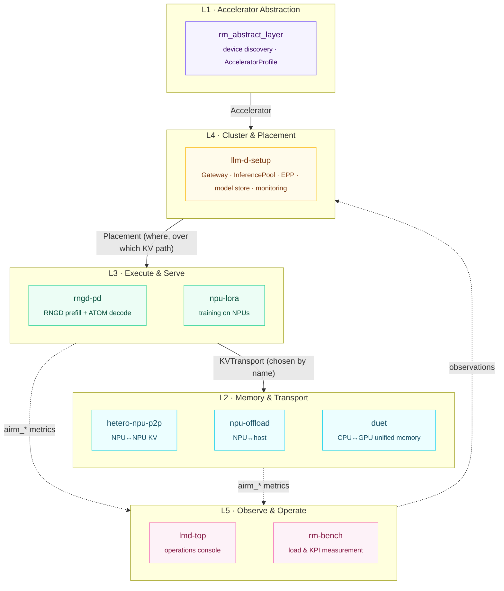

<div align="center">


**English** | [한국어](README.ko.md)

<br>

[](https://github.com/ai-computing/ai-rm/actions/workflows/check-sensitive.yml)
[](https://github.com/ai-computing/rm-core/blob/main/PROTOCOL.md)
[](https://github.com/ai-computing/rm-core)
[](deploy/README.md)
[](https://github.com/ai-computing/rm-core)
[](LICENSE)

**GPUs, NPUs (FuriosaAI RNGD, Rebellions ATOM), CPUs and unified-memory systems (GB10) as one cluster resource**<br>
Five layers — from device discovery to placement, serving, KV movement and observability — connected by contracts

[**Quick start**](#-quick-start) · [**Architecture**](#-architecture) · [**Components**](#-components) · [**How it connects**](#-how-it-connects) · [**Docs**](#-docs) · [**Roadmap**](#-roadmap)

</div>

---

## ✨ Highlights

<table>
<tr>
<td width="33%" valign="top">

### 🧩 Connected by contracts
Components never import each other. Each registers a small adapter that implements a
[rm-core](https://github.com/ai-computing/rm-core) contract, so switching a KV path or a
placement policy is **a name in the config, not a code change**.

</td>
<td width="33%" valign="top">

### ☸️ Kubernetes + llm-d first
Every piece plugs into an extension point llm-d already has — model-server pods, vLLM
`KVConnector`, the EPP — plus an `AcceleratorProfile` CRD that publishes each node's devices.

</td>
<td width="33%" valign="top">

### 📏 One metric language
TTFT, TPOT, tok/s, W and MFU are reported by every layer **under the same names and units**,
so dashboards, benchmarks and KPI tables all point at the same numbers.

</td>
</tr>
</table>

## 🏗 Architecture

Five layers on one loop: observe → decide → act.



Request flow and design principles: [docs/architecture.md](docs/architecture.md).

## 📦 Components

| | Layer | Component | Kind | Role | Maturity |
|:-:|---|---|---|---|---|
| 🟣 | L1 | [rm_abstract_layer](https://github.com/ai-computing/rm_abstract_layer) | library | Heterogeneous accelerator abstraction, device discovery, `AcceleratorProfile` publishing |  |
| 🔵 | L2 | hetero-npu-p2p | library | Same-host KV transfer between NPUs of different vendors (completion-fenced) |  |
| 🔵 | L2 | npu-offload | service | MoE expert offloading (hot experts in NPU HBM, cold experts on the host CPU) |  |
| 🔵 | L2 | duet | library | Cooperative CPU+GPU vector search on GB10 unified memory |  |
| 🟢 | L3 | rngd-pd | service | Prefill/decode-disaggregated serving: RNGD prefill + ATOM decode as llm-d pods |  |
| 🟢 | L3 | npu-lora | workload | LoRA and full fine-tuning on inference-only NPUs |  |
| 🟡 | L4 | llm-d-setup | cluster | Heterogeneous k8s + llm-d cluster, EPP, monitoring stack |  |
| 🩷 | L5 | lmd-top | tool | Observability and operations console for llm-d clusters (TUI) |  |
| 🩷 | L5 | rm-bench | tool | Trace replay and synthetic load; TTFT/TPOT/E2E measurement |  |

> [!NOTE]
> Component repositories are private and included as submodules under `components/<layer>/<repo>`;
> only members of the ai-computing organization can fetch them. Each repository declares its layer,
> install, test and deployment steps in an [`ai-rm.yaml`](docs/component-contract.md) at its root.

## 🚀 Quick start

```bash
git clone --recursive https://github.com/ai-computing/ai-rm.git && cd ai-rm
make doctor     # check prerequisites
make list       # components · layers · versions · deployability
make setup      # install everything (LAYER=l2-memory for one layer)
make test       # quick tests that need no accelerator
make check      # scan for internal IPs, tokens and keys
```

<details>
<summary><b>Deploy to Kubernetes</b></summary>

```bash
mkdir -p deploy/clusters/local
cp deploy/clusters/example/cluster.example.env deploy/clusters/local/cluster.local.env
$EDITOR deploy/clusters/local/cluster.local.env          # site values (never tracked)
make deploy CLUSTER=local DRY_RUN=1                       # review what will be applied
make deploy CLUSTER=local LAYER=l3-serving                # deploy one layer
```

Applies each component's `deploy.chart` / `deploy.manifests`. See [deploy/README.md](deploy/README.md).
</details>

<details>
<summary><b>All <code>make</code> targets</b></summary>

| Target | What it does |
|---|---|
| `make init` | Fetch submodules |
| `make list [LAYER=…]` | Components, layer, kind, maturity, version, deployment target |
| `make doctor` | git · python · kubectl · helm · cargo · docker, missing submodules, site settings |
| `make setup [LAYER=…] [COMPONENTS=…]` | Run each `ai-rm.yaml` `install` step |
| `make test [LAYER=…]` | Run each `ai-rm.yaml` `test` step |
| `make deploy CLUSTER=… [DRY_RUN=1]` | Apply manifests / charts |
| `make check` | Sensitive-data scan over ai-rm and every fetched component |
| `make bump COMPONENT=…` | Move a component to its latest commit (commit ai-rm to pin it) |
</details>

## 🔌 How it connects

Components implement an rm-core contract, register it as an entry point, and are selected **by name** at runtime.

```toml
# hetero-npu-p2p/pyproject.toml
[project.entry-points."airm.kv_transports"]
p2p = "hetero_p2p.airm:P2PTransport"
```

```python
from rm_core import registry
transport = registry.load("airm.kv_transports", "p2p")   # config: kvTransport: p2p | shm | loopback
```

```bash
python -m rm_core.conformance        # contract checks for every installed implementation (PASS / SKIP / FAIL)
```

| Contract | Entry-point group | Layer |
|---|---|---|
| `AcceleratorProvider` | `airm.accelerator_providers` | L1 |
| `KVTransport` | `airm.kv_transports` | L2 |
| `Placement` | `airm.placements` | L4 |
| workload runner | `airm.workloads` | L3 |
| Metrics (`airm_*`) | — | all |

## 📚 Docs

| Document | Contents |
|---|---|
| [rm-core PROTOCOL.md](https://github.com/ai-computing/rm-core/blob/main/PROTOCOL.md) | Normative definition of the contracts (v0.1) |
| [architecture.md](docs/architecture.md) | Layers, request flow, repository principles |
| [interfaces.md](docs/interfaces.md) | Contract summary, mapping to existing code, shared metrics |
| [integration-guide.md](docs/integration-guide.md) | How to connect a component (adapter · entry point · metrics · Helm) |
| [components/](docs/components/) | Per-repository integration cards |
| [component-contract.md](docs/component-contract.md) | `ai-rm.yaml` schema |
| [kpi-map.md](docs/kpi-map.md) | Project KPIs ↔ layers and components |
| [security.md](docs/security.md) | Rules and checks for a public repository |

> The design documents under `docs/` are currently written in Korean.

## 🗺 Roadmap

- [x] Layered structure · submodules · setup tooling (`make list/setup/test/deploy/check`)
- [x] rm-core v0.1 contracts · reference implementations · conformance checks · `AcceleratorProfile` CRD
- [ ] Component adapters for protocol v0.1 — in review
- [ ] Umbrella Helm chart + simulated cluster (`make up-sim`) + end-to-end scenario
- [ ] Placement controller and EPP scorer — choose P:D ratio and KV path from live observations
- [ ] MFU · power efficiency · SLO computed automatically from every end-to-end run
- [ ] Protocol v0.2 — bind live buffers (`MemoryRegion`) to KV transfers

## 🔒 Security

This repository is public. It never contains internal addresses, credentials or unpublished
performance numbers, and every push is [scanned automatically](.github/workflows/check-sensitive.yml).
Site values live only in the untracked `cluster.local.env` — see [docs/security.md](docs/security.md).

## 📄 License

BSD-3-Clause. Each component is licensed under the terms of its own repository.

<div align="center"><sub>Built by the ai-computing team · ETRI</sub></div>
