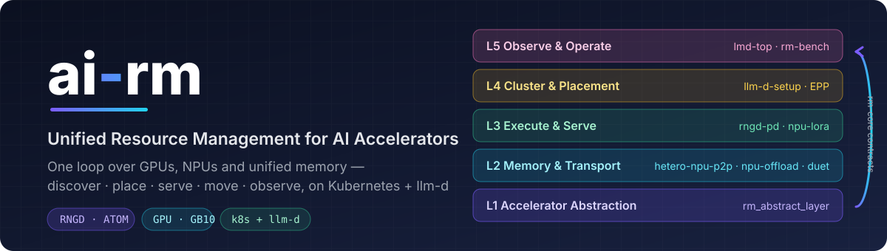
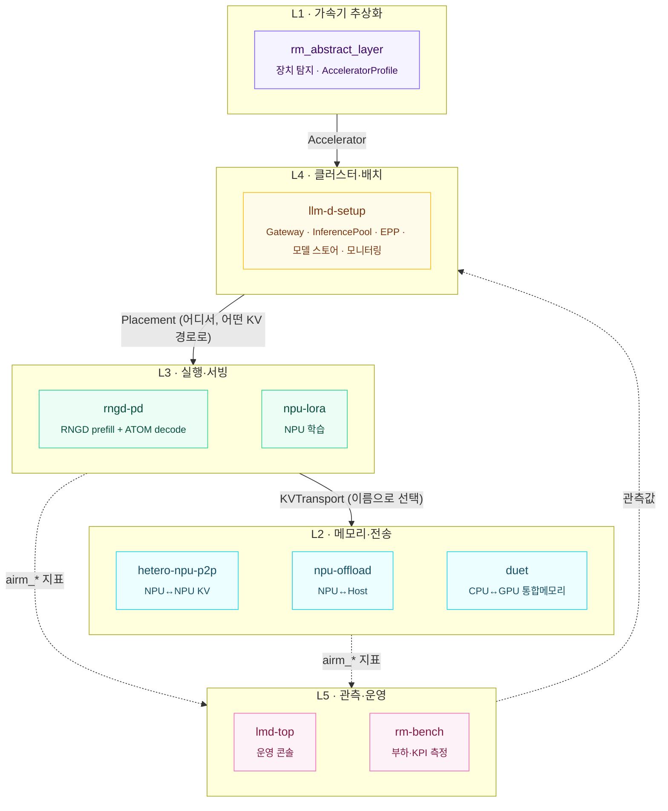

<div align="center">



<br>

[](https://github.com/ai-computing/ai-rm/actions/workflows/check-sensitive.yml)
[](https://github.com/ai-computing/rm-core/blob/main/PROTOCOL.md)
[](https://github.com/ai-computing/rm-core)
[](deploy/README.md)
[](https://github.com/ai-computing/rm-core)
[](LICENSE)

**GPU · NPU(FuriosaAI RNGD, Rebellions ATOM) · CPU · 통합메모리(GB10)를 하나의 클러스터 자원으로**<br>
장치 발견부터 배치·서빙·KV 이동·관측까지, 계약으로 연결된 다섯 계층

[**빠른 시작**](#-빠른-시작) · [**아키텍처**](#-아키텍처) · [**구성요소**](#-구성요소) · [**연결 방식**](#-연결-방식) · [**문서**](#-문서) · [**로드맵**](#-로드맵)

</div>

---

## ✨ 특징

<table>
<tr>
<td width="33%" valign="top">

### 🧩 계약으로 연결
구성요소끼리 서로 import하지 않습니다. [rm-core](https://github.com/ai-computing/rm-core)의 계약을 구현한 작은 adapter만 등록하면,
KV 경로·배치 정책이 **코드 수정이 아니라 설정의 이름**으로 바뀝니다.

</td>
<td width="33%" valign="top">

### ☸️ k8s + llm-d 기본
각 기술은 llm-d가 이미 정해 둔 확장 지점에 붙습니다 — 모델 서버 pod, vLLM `KVConnector`, EPP, 그리고 노드의 장치를 게시하는 `AcceleratorProfile` CRD.

</td>
<td width="33%" valign="top">

### 📏 하나의 지표 언어
TTFT·TPOT·tok/s·W·MFU를 모든 계층이 **같은 이름과 단위**로 냅니다. 대시보드, 벤치마크, 과제 KPI 표가 같은 수치를 가리킵니다.

</td>
</tr>
</table>

## 🏗 아키텍처

관측 → 결정 → 실행의 한 루프 위에 다섯 계층이 올라갑니다.



자세한 흐름과 설계 원칙은 [docs/architecture.md](docs/architecture.md).

## 📦 구성요소

| | 계층 | 구성요소 | 종류 | 역할 | 성숙도 |
|:-:|---|---|---|---|---|
| 🟣 | L1 | [rm_abstract_layer](https://github.com/ai-computing/rm_abstract_layer) | library | 이종 가속기 추상화, 장치 탐지, `AcceleratorProfile` 게시 |  |
| 🔵 | L2 | hetero-npu-p2p | library | 같은 호스트 이종 NPU 간 KV 전송 (completion-fenced) |  |
| 🔵 | L2 | npu-offload | service | MoE 전문가 오프로딩 (hot: NPU HBM, cold: host CPU) |  |
| 🔵 | L2 | duet | library | GB10 통합메모리 CPU+GPU 협업 벡터 검색 |  |
| 🟢 | L3 | rngd-pd | service | RNGD prefill + ATOM decode PD 분리 서빙 (llm-d pod) |  |
| 🟢 | L3 | npu-lora | workload | 추론 전용 NPU에서의 LoRA·full fine-tuning |  |
| 🟡 | L4 | llm-d-setup | cluster | 이종 가속기 k8s + llm-d 클러스터, EPP, 모니터링 스택 |  |
| 🩷 | L5 | lmd-top | tool | llm-d 클러스터 관측·운영 콘솔 (TUI) |  |
| 🩷 | L5 | rm-bench | tool | trace 재생·합성 부하, TTFT/TPOT/E2E 측정 |  |

> [!NOTE]
> 구성요소 repo는 비공개이며 `components/<layer>/<repo>` 서브모듈로 들어 있습니다. ai-computing 조직 멤버만 받을 수 있습니다.
> 각 repo는 루트의 [`ai-rm.yaml`](docs/component-contract.md)로 계층·설치·테스트·배포 방법을 선언합니다.

## 🚀 빠른 시작

```bash
git clone --recursive https://github.com/ai-computing/ai-rm.git && cd ai-rm
make doctor     # 사전 조건 점검
make list       # 구성요소 · 계층 · 버전 · 배포 가능 여부
make setup      # 전체 설치 (LAYER=l2-memory 로 계층만)
make test       # 가속기 없이 도는 빠른 테스트
make check      # 내부 IP · 토큰 · 키 검사
```

<details>
<summary><b>k8s에 배포하기</b></summary>

```bash
mkdir -p deploy/clusters/local
cp deploy/clusters/example/cluster.example.env deploy/clusters/local/cluster.local.env
$EDITOR deploy/clusters/local/cluster.local.env          # 사이트 값 (추적되지 않음)
make deploy CLUSTER=local DRY_RUN=1                       # 적용 계획 확인
make deploy CLUSTER=local LAYER=l3-serving                # 계층별 배포
```

각 구성요소의 `deploy.chart`/`deploy.manifests`를 적용합니다. 자세한 내용은 [deploy/README.md](deploy/README.md).
</details>

<details>
<summary><b><code>make</code> 명령 전체</b></summary>

| 명령 | 하는 일 |
|---|---|
| `make init` | 서브모듈 받기 |
| `make list [LAYER=…]` | 구성요소, 계층, 종류, 성숙도, 버전, 배포 대상 |
| `make doctor` | git · python · kubectl · helm · cargo · docker, 받지 않은 서브모듈, 사이트 설정 |
| `make setup [LAYER=…] [COMPONENTS=…]` | `ai-rm.yaml`의 `install` 실행 |
| `make test [LAYER=…]` | `ai-rm.yaml`의 `test` 실행 |
| `make deploy CLUSTER=… [DRY_RUN=1]` | 매니페스트/차트 적용 |
| `make check` | ai-rm과 받은 구성요소 전체의 민감정보 검사 |
| `make bump COMPONENT=…` | 구성요소를 최신 커밋으로 올리기 (ai-rm에 커밋해서 고정) |
</details>

## 🔌 연결 방식

구성요소는 rm-core의 계약을 구현해 entry point로 등록하고, 실행 시에는 설정의 **이름**으로 고릅니다.

```toml
# hetero-npu-p2p/pyproject.toml
[project.entry-points."airm.kv_transports"]
p2p = "hetero_p2p.airm:P2PTransport"
```

```python
from rm_core import registry
transport = registry.load("airm.kv_transports", "p2p")   # 설정: kvTransport: p2p | shm | loopback
```

```bash
python -m rm_core.conformance        # 설치된 모든 구현의 계약 적합성 검사 (PASS / SKIP / FAIL)
```

| 계약 | entry-point 그룹 | 계층 |
|---|---|---|
| `AcceleratorProvider` | `airm.accelerator_providers` | L1 |
| `KVTransport` | `airm.kv_transports` | L2 |
| `Placement` | `airm.placements` | L4 |
| workload runner | `airm.workloads` | L3 |
| Metrics (`airm_*`) | — | 전 계층 |

## 📚 문서

| 문서 | 내용 |
|---|---|
| [rm-core PROTOCOL.md](https://github.com/ai-computing/rm-core/blob/main/PROTOCOL.md) | 계약의 규범 정의 (v0.1) |
| [architecture.md](docs/architecture.md) | 계층, 요청 흐름, 저장소 구성 원칙 |
| [interfaces.md](docs/interfaces.md) | 계약 요약과 기존 코드 대응, 공통 지표 표 |
| [integration-guide.md](docs/integration-guide.md) | 구성요소를 연결하는 방법 (adapter · entry point · 지표 · Helm) |
| [components/](docs/components/) | repo별 통합 카드 |
| [component-contract.md](docs/component-contract.md) | `ai-rm.yaml` 스키마 |
| [kpi-map.md](docs/kpi-map.md) | 과제 성과지표 ↔ 계층·구성요소 대응 |
| [security.md](docs/security.md) | 공개 저장소 보안 규칙과 검사 |

## 🗺 로드맵

- [x] 계층 구조 · 서브모듈 · 셋업 도구 (`make list/setup/test/deploy/check`)
- [x] rm-core v0.1 계약 · 참조 구현 · 적합성 검사 · `AcceleratorProfile` CRD
- [ ] 구성요소 adapter 통합 (protocol v0.1) — 리뷰 진행 중
- [ ] umbrella Helm chart + 시뮬레이션 클러스터(`make up-sim`) + end-to-end 시나리오
- [ ] 배치 컨트롤러와 EPP scorer — 관측값으로 P:D 비율과 KV 경로 결정
- [ ] end-to-end 실행마다 MFU · 전력효율 · SLO 자동 산출 → KPI 표
- [ ] protocol v0.2 — KV 전송에 실제 버퍼(`MemoryRegion`) 바인딩

## 🔒 보안

이 저장소는 공개입니다. 내부 주소, 자격 증명, 공개 전 성능 수치는 넣지 않으며 모든 push를 [자동 검사](.github/workflows/check-sensitive.yml)합니다.
사이트 값은 추적되지 않는 `cluster.local.env`에만 둡니다 — [docs/security.md](docs/security.md).

## 📄 License

BSD-3-Clause. 각 구성요소의 라이선스는 해당 repo를 따릅니다.

<div align="center"><sub>Built by the ai-computing team · ETRI</sub></div>
