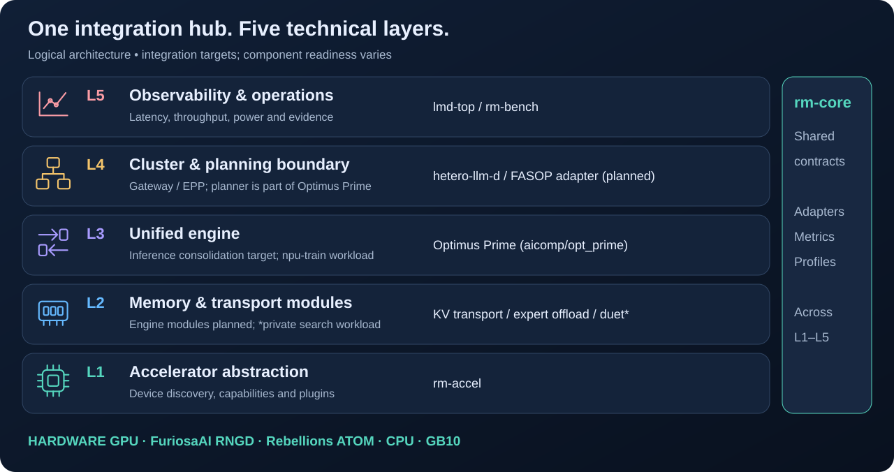
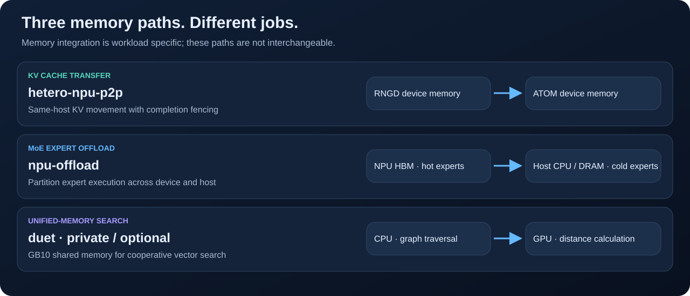

# Architecture

[Documentation](README.md) · [한국어](ko/architecture.md)

AI-RM's logical architecture separates resource description, data movement, workload execution, cluster integration and observation. The default target environment is Kubernetes + llm-d. **The diagram describes intended integration responsibilities; component deployment and conformance must be checked separately.**

**Engine ownership:** [Optimus Prime](engine-integration.md) in `aicomp` is the planned unified inference engine, with `opt_prime` as runtime and `fasop` as the product's planner/search element. FASOP connects logically at L4; runtime execution stays at L3, and memory modules at L2. The layered view describes responsibility, not separate source repositories for every box.

## Layer responsibilities

| Layer | Responsibility | Components | Cluster integration point |
|---|---|---|---|
| L1 · Accelerator abstraction | Discover devices; describe memory, precision, peak provenance, power and interconnects | rm-accel | Device information, AcceleratorProfile and node labels; engine selection |
| L2 · Memory and transport | Represent tiers and move workload data | Planned Optimus Prime KV/offload modules; current hetero-npu-p2p/npu-offload sources; private duet workload | Explicit transport and offload boundaries; unified-memory search remains an external workload |
| L3 · Unified engine and workloads | Execute inference under one runtime owner; connect training workloads | Optimus Prime target; rngd-pd migration source; npu-train workload | Planned engine serving adapter; current component pods/Jobs remain until cutover |
| L4 · Cluster and planning | Routing, reviewed planning proposals, storage and monitoring | hetero-llm-d; FASOP adapter planned inside Optimus Prime | Gateway, InferencePool, EPP; no automatic FASOP live reconfiguration |
| L4 · Placement | Choose accelerators for each serving pool and publish the decision | rm-controller (`airm-placement`) | AcceleratorProfiles, node state |
| L5 · Observation and operations | Inspect cluster behavior and generate measurement evidence | lmd-top, rm-bench | Kubernetes / Prometheus readers, endpoint load generation |

## Example request path

1. A client request reaches the Gateway and the llm-d routing/placement integration points.
2. The target serving configuration connects Optimus Prime prefill/decode workers. Existing RNGD prefill + ATOM decode is a migration source; NPU backends and the engine serving adapter require implementation and validation.
3. KV state moves over a named transport. `p2p` requires compatible same-host devices and ABI; `shm` is host staging. Availability is explicit, and transport failure must not silently select another path.
4. Common measurements connect the workload to monitoring and benchmark tools. FASOP's planned adapter produces reviewed proposals; its current training estimates must not be reported as inference SLO measurements. A complete automated placement controller is not established by this diagram.

L1 provides the capability model used by integration logic; it is not a network hop traversed by every request. L5 observes behavior across the stack rather than forwarding inference traffic.

## Memory paths are distinct

- **hetero-npu-p2p:** KV transfer between compatible NPUs on one host, with completion fencing.
- **npu-offload:** partition MoE expert execution across NPU HBM and host CPU/DRAM. Its v0.1 integration uses workload and memory-tier contracts rather than implementing `KVTransport`.
- **duet:** CPU graph traversal and GPU distance calculation share GB10 unified memory for vector search. This component is private and optional.

## Repository and contract boundaries

- Existing implementations remain pinned migration sources. Engine-facing technology is planned to consolidate into `aicomp/opt_prime`, with `aicomp/fasop` as a planner element. Public resource/workload/cluster boundaries remain explicit; see the [ownership map](engine-integration.md).
- [rm-core](https://github.com/ai-computing/rm-core) owns normative protocol definitions and conformance checks. See [interfaces](interfaces.md).
- Submodule commits pin the component combination. A pinned combination alone is not evidence of end-to-end validation.
- Integration code that no component owns lives in ai-rm itself under `packages/`: `rm-bench` (measurement, trace replay) and
  `rm-controller` (L4 placement). They change with ai-rm's profiles and scenarios, so they share its commits. `rm-core` stays a
  separate repository because every component pins it; inside the umbrella it would make components depend on ai-rm.
- NPU vendor backends (RNGD/ATOM graphs, kernels, compile caches) go into `aicomp` with Optimus Prime, not into a separate repository.
- `ai-rm.yaml` declares each component's install/test/deploy metadata. See the [component contract](component-contract.md).
- Site settings remain in untracked `cluster.local.env` files. See [deployment](../deploy/README.md) and [security](security.md).

See [status](status.md) for current integration boundaries and [component cards](components/README.md) for component-specific work.
