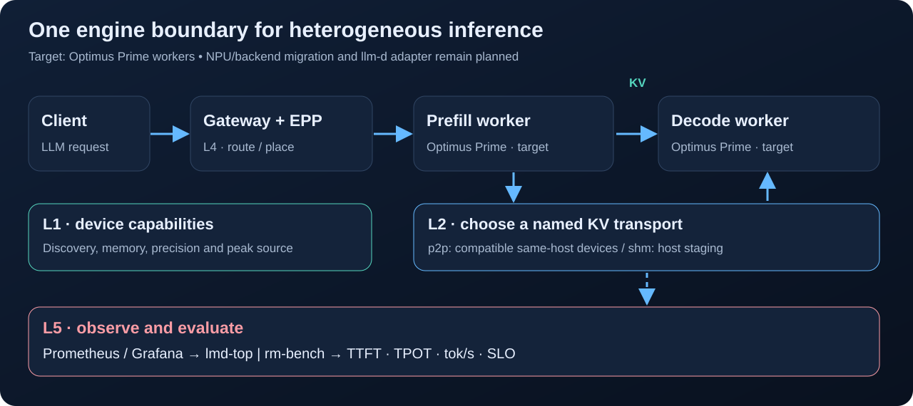
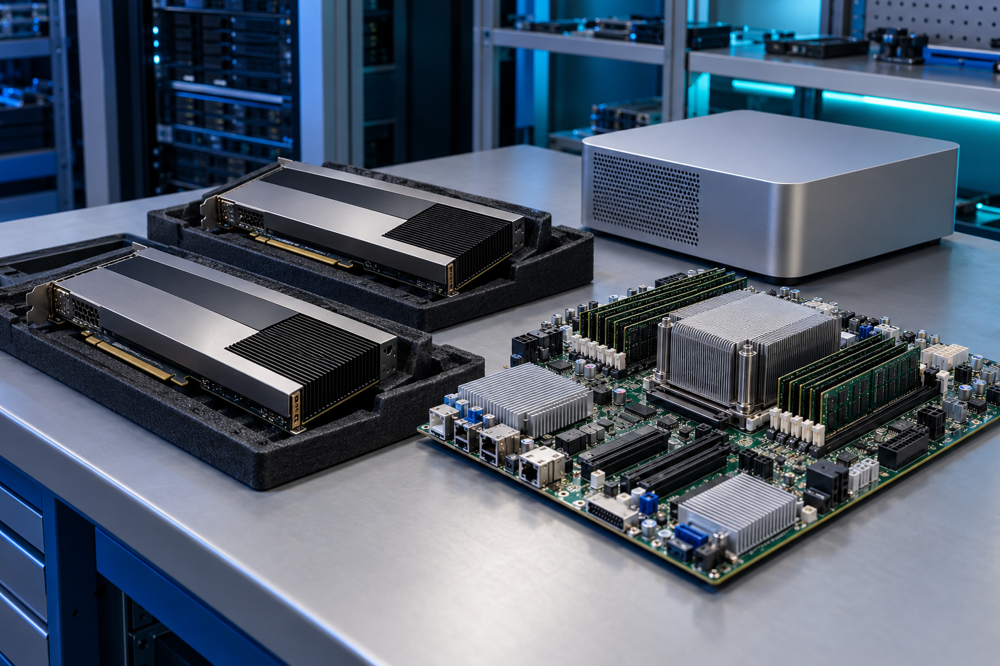

# 연구 시나리오

[문서 홈](README.md) · [English](../research-scenarios.md)

구성요소가 같은 과제에서 어떤 역할을 맡는지 설명하는 **연구·통합 시나리오**입니다. 모든 조합의 검증 완료를 뜻하지 않습니다. 하드웨어·모델·ABI 지원 조건은 각 저장소에서 확인하세요.

[목표 소유권](engine-integration.md)은 aicomp의 Optimus Prime으로 추론 실행·PD·KV·expert offload를 모으는 방향입니다. 아래 기존 저장소는 이전 소스입니다. FASOP은 같은 제품의 계획 요소이며 기존 학습 추정을 서빙에 쓰려면 추론 모델 보정이 필요합니다. 비공개 duet은 외부 검색 workload로 유지합니다.

## 1. 이종 NPU prefill/decode 분리

`rngd-pd`는 RNGD prefill + ATOM decode를 연구합니다. KV는 이름으로 선택한 전송 경로를 사용합니다. `hetero-npu-p2p`의 P2P는 같은 호스트·호환 장치·ABI 조건과 완료 fence를 따르며 `shm`은 host staging입니다.

동일 부하에서 TTFT·TPOT·처리량·KV 전송·SLO를 측정합니다. 실제 경로를 기록하고 staging 결과를 P2P 성능으로 보고하지 않습니다.

## 2. NPU와 호스트의 MoE 전문가 분담

`npu-offload`는 hot expert를 NPU HBM에 두고 cold expert를 호스트 CPU에서 실행합니다. KV 전송과 다른 workload·메모리 계층 통합입니다. 정책·모델을 명시하고 처리량·토큰 지연·측정 가능한 전력을 비교합니다.

## 3. 통합메모리 CPU–GPU 검색

비공개 선택 구성요소 `duet`은 GB10에서 CPU 그래프 순회와 GPU 거리 계산을 협업시킵니다. 데이터셋·검색 설정과 함께 처리량·지연·정확도를 기록합니다. 공개 문서는 역할을 설명하며 비공개 구현을 배포하지 않습니다.

*AI 생성 이미지이며 실제 장비 사진이나 제품 도면이 아닙니다.*

## 4. NPU 학습을 공통 자원 체계에 연결

`npu-train`의 LoRA·full fine-tuning 연구를 workload runner와 Kubernetes Job으로 연결하는 시나리오입니다. Backend·데이터셋과 학습 처리량·정확도를 기록합니다.

## 5. 관측·부하·비교

`hetero-llm-d`는 클러스터·모니터링, `lmd-top`은 운영 화면, `rm-bench`는 trace·합성 부하와 측정을 담당합니다. 공통 이름과 단위를 사용해 운영 화면과 벤치마크가 같은 양을 가리키도록 합니다.

[성과지표](kpi-map.md), [인터페이스](interfaces.md), [현재 상태](status.md)를 함께 참고하세요.
